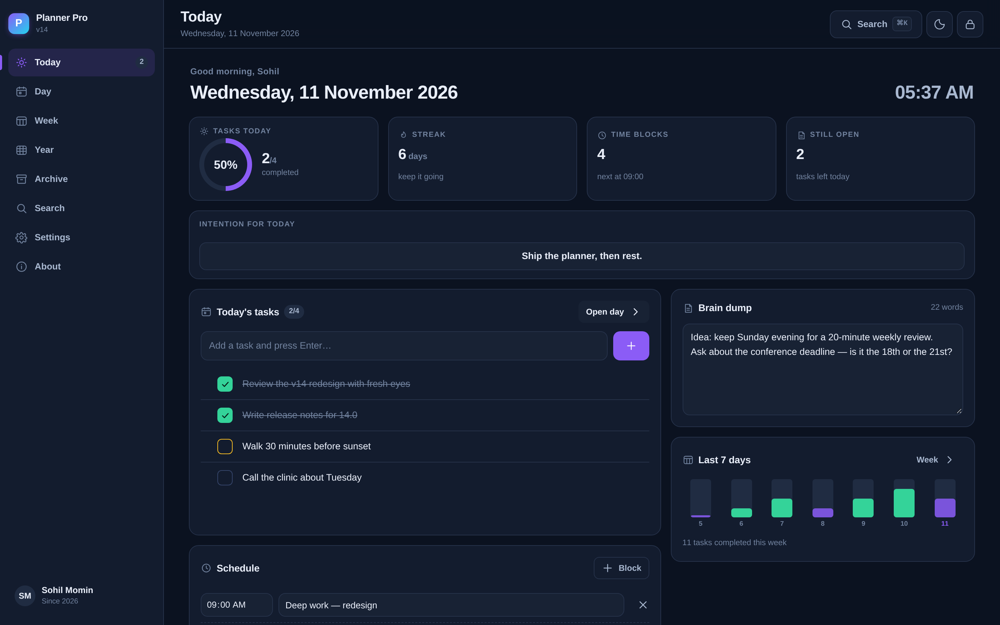
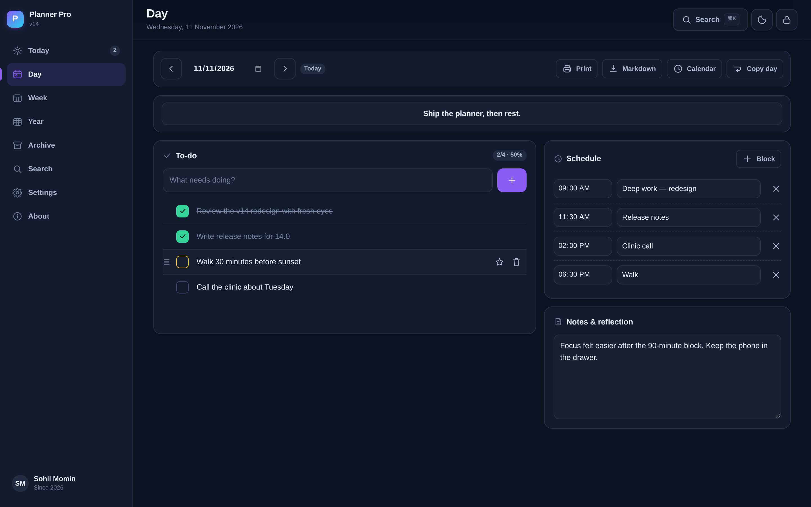
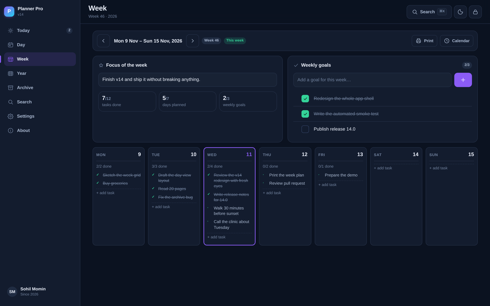
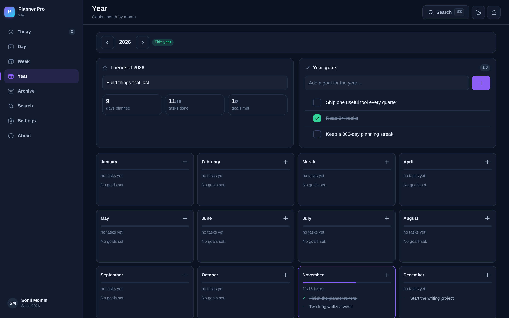
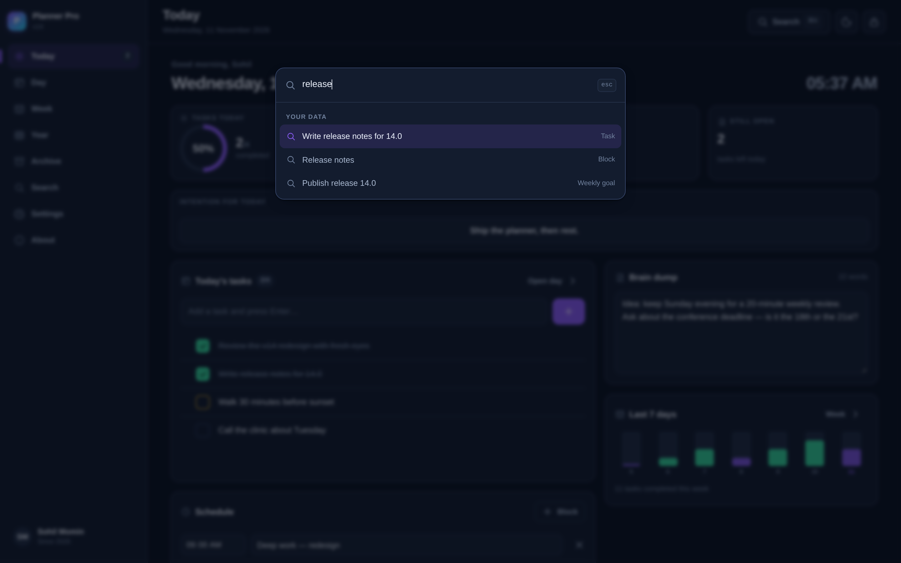
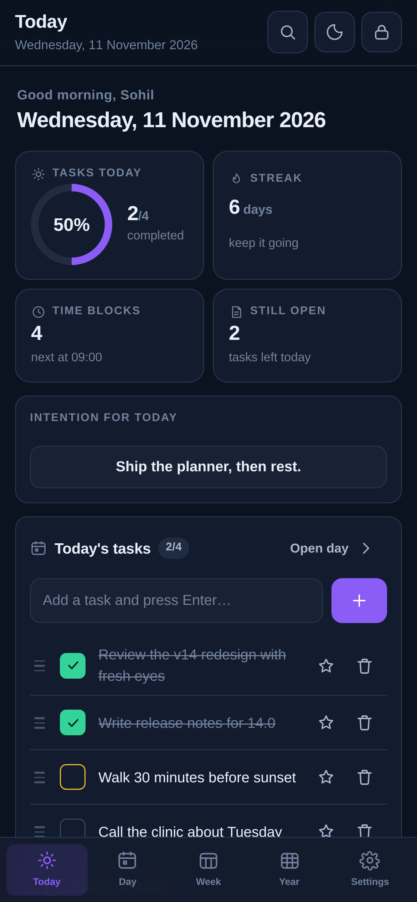
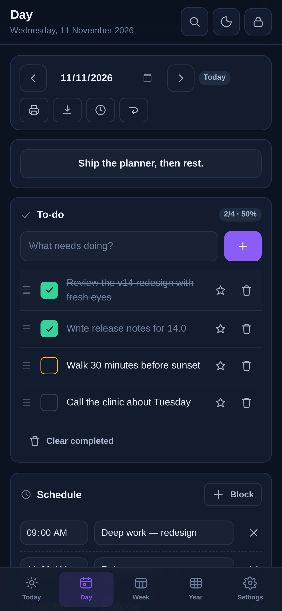
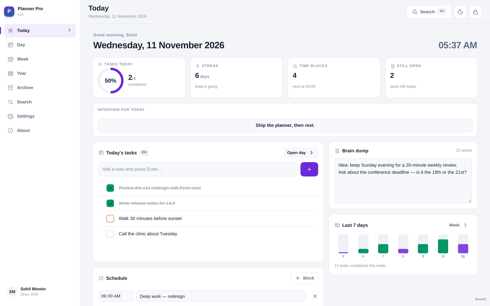
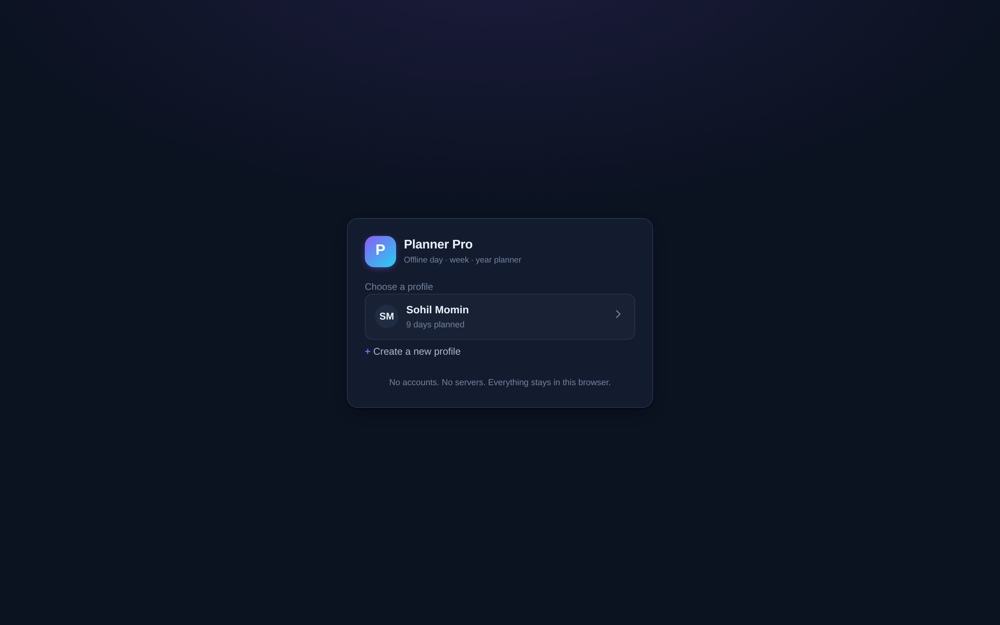

<p align="center">
  
</p>

<h1 align="center">Planner Pro</h1>

<p align="center"><strong>An offline-first planner that behaves like a tool, not a website.</strong><br>
Day, week, month and year planning in one quiet screen. Multi-profile, PIN-locked, no accounts, no servers.</p>

<p align="center">
  <a href="https://drsamonline.github.io/planner-pro/"></a>
  <a href="https://github.com/drsamonline/planner-pro/releases/latest"></a>
  <a href="https://github.com/sponsors/drsamonline"></a>
</p>

<p align="center">
  
  
  
  
  
  
</p>

<p align="center">
  
  
  
  
</p>

---



## Why another planner

Most planners are either a website with a calendar bolted on, or a subscription
that owns your data. Planner Pro is a single small app you can open from a file,
install as a PWA, or build into an APK/EXE. It loads instantly, works on a plane,
and stores everything on your device.

- **Zero runtime dependencies.** No React, no build step, no CDN, no fonts to fetch. ~120 KB of HTML/CSS/JS.
- **Genuinely offline.** A service worker precaches the whole shell; the app opens in under a second with the network off.
- **Local-first data.** One versioned `localStorage` document, exported to JSON in one click. Your planner is a file you own.
- **Fast by construction.** Views render in a single string pass with event delegation — no virtual DOM, no re-render churn, no spinners.

## Screenshots

| Day | Week |
|---|---|
|  |  |

| Year | Command palette |
|---|---|
|  |  |

| Mobile — Today | Mobile — Day | Light theme |
|---|---|---|
|  |  |  |

<p align="center">
  
</p>

## Features

**Planning**
- **Today** — greeting, live clock, completion ring, streak, time-block count, open-task count, 7-day completion bars, brain dump.
- **Day** — intention line, to-do list with priorities and inline editing, time blocks with a live "now" highlight, notes & reflection.
- **Week** — real calendar weeks (not "every Monday forever"), weekly focus, weekly goals, seven day columns with completion counts.
- **Year** — year theme, year goals, twelve month cards with goals and task progress.
- **Archive** — finished years move out of the way automatically; restore, export or delete any of them.
- **Carry over** — pull yesterday's unfinished tasks into today in one click.
- **Undo and a 30-day trash** — every delete is reversible, twice over.
- **Drag to reorder** — order is meaning in a plan; move a task or block by its handle.

**Craft**
- Multi-profile with a 4-digit PIN, PIN asked on launch (configurable), profiles never see each other's data.
- Command palette (`Ctrl/⌘ K`) that searches every task, note, block and goal, runs commands, and understands dates (`tomorrow`, `next friday`, `25 dec`).
- Keyboard shortcuts for everything (`N`, `T`, `D`, `W`, `Y`, `A`, `/`, `1–5`).
- Four themes — Midnight, Ocean, Light and System — with correct contrast in each.
- Layout that actually fits: 3-column desktop, icon rail on tablets, bottom tab bar + FAB on phones, no horizontal scroll at 320 px.
- 44 px touch targets, visible focus rings, `aria-current` navigation, reduced-motion support.
- Print stylesheet — printing a day or a week gives you clean paper output.
- Markdown export for a single day or the whole planner; **ICS export** for a day or a week, so the plan lands in your calendar.
- Inline editing — click a task, fix it, press Enter. No dialog.
- **Keyboard-first list** — `j`/`k` to move, `x` to tick, `e` to edit, `Alt+↑/↓` to reorder.
- **Quick add reads English** — "call the clinic tomorrow 4pm #health" fills the date, time and tag, with a live preview of what will be saved.
- **Copy a day** — pull yesterday's blocks and tasks into today (or any date) in one dialog.
- A backup nudge if you have not exported in 14 days, and a prompt when a new version is cached.

**Data**
- One JSON document, versioned, with automatic migration from the v13 layout.
- Debounced saves, a "Saved" indicator, corrupt-document quarantine, quota-failure warnings.
- Import/export the whole database; export any archive separately.

## Quick start

**Use it online** — [drsamonline.github.io/planner-pro](https://drsamonline.github.io/planner-pro/app/)

**Install as an app**

| Platform | How |
|---|---|
| Android / ChromeOS | Open the site → menu → **Install app** (or **Add to Home screen**) |
| iPhone / iPad | Open in Safari → Share → **Add to Home Screen** |
| Windows / macOS / Linux | Open the site → install icon in the address bar |
| No browser install | Download `planner-pro.html` — one file, double-click it |

### Release downloads

Built by CI from the tagged commit (Windows and macOS binaries are unsigned, so
SmartScreen/Gatekeeper will ask you to confirm the first launch):

| File | Platform | What it is |
|---|---|---|
| [`planner-pro.html`](https://github.com/drsamonline/planner-pro/releases/latest/download/planner-pro.html) | any | The entire app in one file — no server, no internet |
| [`planner-pro-web.zip`](https://github.com/drsamonline/planner-pro/releases/latest/download/planner-pro-web.zip) | any | Offline web build: unzip, open `index.html` |
| [`planner-pro-14.1.0-windows-setup.exe`](https://github.com/drsamonline/planner-pro/releases/latest/download/planner-pro-14.1.0-windows-setup.exe) | Windows | Installer (Electron) |
| [`planner-pro-14.1.0-windows-portable.exe`](https://github.com/drsamonline/planner-pro/releases/latest/download/planner-pro-14.1.0-windows-portable.exe) | Windows | Portable, no install |
| [`planner-pro-14.1.0-macos-arm64.dmg`](https://github.com/drsamonline/planner-pro/releases/latest/download/planner-pro-14.1.0-macos-arm64.dmg) | macOS (Apple silicon) | Disk image |
| [`planner-pro_14.1.0_amd64.deb`](https://github.com/drsamonline/planner-pro/releases/latest/download/planner-pro_14.1.0_amd64.deb) | Debian / Ubuntu | Package |
| [`planner-pro-14.1.0-android.apk`](https://github.com/drsamonline/planner-pro/releases/latest/download/planner-pro-14.1.0-android.apk) | Android | Debug APK — sideload it, or `adb install planner-pro-14.1.0-android.apk` |

**Run from source**

```bash
git clone https://github.com/drsamonline/planner-pro.git
cd planner-pro
python3 -m http.server 8080 --directory app
# open http://localhost:8080
```

> Opening `app/index.html` directly from disk works too — the app is written as
> classic scripts, not ES modules, exactly so `file://` keeps working. The service
> worker only registers over http(s), so "offline" is automatic either way.

## Keyboard shortcuts

| Keys | Action |
|---|---|
| `Ctrl / ⌘ + K` | Command palette — search everything, run any command |
| `J` / `K` | Move down / up the task list |
| `X` / `E` | Tick / edit the focused task |
| `Alt + ↑ / ↓` | Move the focused task up or down |
| `N` | Quick add a task to any day |
| `T` / `D` / `W` / `Y` / `A` | Today · Day · Week · Year · Archive |
| `1` – `5` | Switch the main views |
| `/` | Search |
| `Esc` | Close palette, dialog or search |

## Data model

```js
{
  v: 14,
  activeUser: "1234",
  users: {
    "1234": {
      name: "Sohil Momin", theme: "midnight", weekStart: 1,
      quickNotes: "",
      days:   { "2026-11-10": { intention, notes, todos: [...], blocks: [...] } },
      weeks:  { "2026-11-09": { focus, todos: [...] } },   // keyed by the week's first day
      months: { "2026-11":     { focus, goals: [...] } },
      years:  { "2026":        { theme, goals: [...] } },
      archives: { "2025": { days, weeks, months, years } }
    }
  }
}
```

Days are keyed by the full date, so moving across a year boundary no longer
writes to the wrong year (that was the v13 bug). Weeks are keyed by their start
date, so a plan belongs to *one* week instead of repeating every week.

## Building

```bash
npm install          # dev tooling only: puppeteer-core + electron-builder
npm test             # 73 end-to-end checks in headless Chromium
npm run build:single # one portable planner-pro.html
npm run build:web    # zip of the offline web build in dist/
```

| Target | Command / workflow | Output |
|---|---|---|
| Web (offline, minified) | `npm run build:web` | `dist/planner-pro-web.zip` (−27 % assets) |
| Single HTML file | `npm run build:single` | `dist/planner-pro.html` |
| Android APK | [`.github/workflows/android.yml`](.github/workflows/android.yml) | `app-debug.apk` via Capacitor (JDK 21) |
| Windows / macOS / Linux | [`.github/workflows/desktop.yml`](.github/workflows/desktop.yml) | `.exe`, `.dmg`, `.AppImage`, `.deb` via Electron |

Desktop and Android binaries are built by CI, not on a developer machine: they
need an Android SDK and per-OS toolchains. Push a `v*` tag (or run the workflow
from the **Actions** tab) and the artifacts attach to the release.

To sign them for distribution you will additionally need a keystore for Android
and code-signing certificates for Windows/macOS — see
[`build/android/README.md`](build/android/README.md).

## Roadmap

The full, prioritised list of what could be added next — and what is deliberately
left out to keep the app small — is in [ENHANCEMENTS.md](ENHANCEMENTS.md).

Highlights: recurring tasks, ICS/calendar import-export, encrypted backups,
optional cloud sync via a file the user owns, per-day attachments, a focus timer,
and a "review" mode for weekly/monthly reflection.

## Privacy

No analytics, no telemetry, no network requests after the shell is cached. The
only outbound links are the ones in this README and the About screen. If you
clear site data, the planner starts empty — export a backup first.

## Author

**Dr. Sohil Momin** — built this to run his own days.
[GitHub](https://github.com/drsamonline) · [Sponsor this work](https://github.com/sponsors/drsamonline)

## Sponsor

Planner Pro is free for personal use and developed on unpaid time. If it earns
a place in your day, you can [sponsor the work](https://github.com/sponsors/drsamonline) —
sponsorship pays for the release builds and keeps the licence non-commercial.

## License

[PolyForm Noncommercial 1.0.0](LICENSE) — free for personal, academic, hobby,
charitable and government use. **Commercial use requires a written licence** from
the author. See [ATTRIBUTION.md](ATTRIBUTION.md) for the ideas and books this
planner draws on.

<p align="center"><sub>Made for people who plan on paper but live on a screen.</sub></p>
